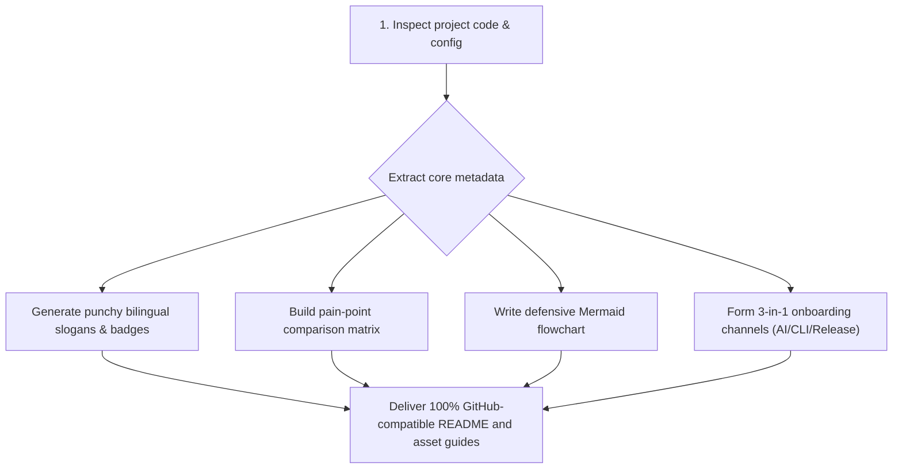

<p align="right">
  <a href="./README.md">简体中文</a> | <strong>English</strong>
</p>

<div align="center">

<!-- [Placeholder] Hero Banner: 1200x420, see assets/README.md -->
<!--  -->

# 🎨 readme-craft

<p align="center">
  <b>One-Click Landing-Page Grade README Architect for Indie Makers & Open Source Projects</b><br>
  Say goodbye to ugly scratchpads. Minimalist bilingual switcher, 3-in-1 onboarding matrix, 100% GitHub-safe Mermaid diagrams, and feature comparison tables.
</p>

<p align="center">
  
  
  
  
</p>

<p align="center">
  <a href="#-why-readme-craft"><b>💡 Why This</b></a> •
  <a href="#-pipeline"><b>🔄 Pipeline</b></a> •
  <a href="#-quickstart"><b>🚀 Quickstart</b></a> •
  <a href="#-usage"><b>✨ How to Use</b></a> •
  <a href="#-license"><b>📄 License</b></a>
</p>

</div>

---

## 💡 Why readme-craft

| Dimension | Typical Sloppy README | Bloated Enterprise Template | `readme-craft` Solution |
| :--- | :--- | :--- | :--- |
| **First Impression** | Plain text wall, looks like a personal scratchpad | Excessive dual theme images, complex sponsor walls | **Clean 5-Tier Funnel**: Centered Hero + flat shields badges + clean placeholders |
| **Onboarding** | Bare `npm install`, missing OS context | Fragmented multi-page docs site | **3-in-1 Matrix**: Agent Prompt install + CLI + Releases |
| **Architecture** | No diagram or blurry static screenshots | Heavy external drawing tools | **GitHub-Safe Pure Mermaid**: Zero external image dependency, dark mode native |
| **Bilingual Support** | English-only misses local dev, Chinese-only loses global traffic | Heavy CI automated translation clutter | **Top-right Clean Switch**: Smooth toggle between `README.md` and `README.en.md` |

---

## 🔄 Generation Pipeline



---

## 🚀 Quickstart

### Option 1: AI Agent One-Click Install (Recommended)
Copy and send this prompt to your AI coding assistant (Claude Code / Cursor / Codex / ZCode):
```text
Please install this Agent Skill: https://github.com/guxiao7538/readme-craft
Read its SKILL.md and help me craft a high-impact README for the current project.
```

### Option 2: Geek CLI Clone
```bash
# Global user-level install (Claude Code / ZCode)
git clone https://github.com/guxiao7538/readme-craft.git ~/.claude/skills/readme-craft

# Or local project-level install
git clone https://github.com/guxiao7538/readme-craft.git .claude/skills/readme-craft
```

### Option 3: Direct Release Download
👉 Go to [GitHub Releases](../../releases) to download the packaged release bundle.

---

## ✨ How to Use

Once installed, simply say to your AI assistant:
- *"Help me craft a stunning README for this repository"*
- *"Refactor the existing README.md into a landing-page style"*
- *"Polish documentation layout following readme-craft standards"*

---

## 📄 License

Distributed under the [MIT](LICENSE) License.
