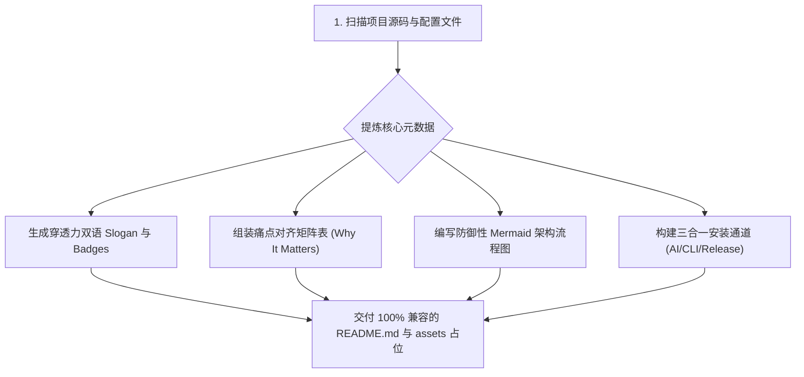

<p align="right">
  <strong>简体中文</strong> | <a href="./README.en.md">English</a>
</p>

<div align="center">

<!-- [占位] 顶部主视觉横幅：宽屏 1200x420，详见 assets/README.md -->
<!--  -->

# 🎨 readme-craft

<p align="center">
  <b>一键生成落地页级工业范式 README • 专为独立开发者与个人开源项目量身打造</b><br>
  告别丑陋记事本。中英双语极简切换、三合一安装通道、100% 兼容 GitHub 的 Mermaid 流程图与痛点矩阵。
</p>

<p align="center">
  
  
  
  
</p>

<p align="center">
  <a href="#-核心代差"><b>💡 核心代差</b></a> •
  <a href="#-生成工作流"><b>🔄 核心流水线</b></a> •
  <a href="#-三合一极速上手"><b>🚀 极速安装</b></a> •
  <a href="#-设计规范亮点"><b>✨ 核心特性</b></a> •
  <a href="#-开源协议"><b>📄 开源协议</b></a>
</p>

</div>

---

## 💡 核心代差 (Why readme-craft)

| 核心维度 | 传统草率 README | 复杂大厂模板库 | `readme-craft` 解决方案 |
| :--- | :--- | :--- | :--- |
| **首屏视觉** | 纯文字平铺直叙，像个人备忘录，读者 3 秒关掉 | 强行堆砌多套深浅色图、赞助墙，维护极繁重 | **极简 5 级漏斗**：Hero 居中 + 统一扁平徽章 + 标准图片占位，清爽抓人 |
| **安装指引** | 只有单薄的一行 `npm install` 或缺少环境依赖 | 拆分多页面文档站，跳转成本高 | **三合一分流矩阵**：AI 一键安装 Prompt + 极客 CLI + Releases 直达 |
| **技术流程** | 没有图或放外部静态截图，后续改动需重新切图 | 使用复杂画图软件，源文件容易遗失 | **GitHub-Safe 纯文本 Mermaid**：强转义、零外部图片依赖、暗黑模式原生适配 |
| **双语体验** | 纯中文失掉海外曝光，纯英文中文受众读着累 | 脚本自动化生成多语言导致目录杂乱 | **右上角单行直达**：`README.md` 与 `README.en.md` 极简无感互切 |

---

## 🔄 核心流水线 (Generation Pipeline)



---

## 🚀 三合一极速安装 (Quickstart)

### 姿势一：AI 助手一键安装 (推荐)
复制以下指令发给你的日常 AI 编程助手（Claude Code / Cursor / Codex / ZCode）：
```text
请帮我安装这个 Agent Skill: https://github.com/guxiao7538/readme-craft
读取其中的 SKILL.md，并协助我为当前项目编写/重构高质感 README。
```

### 姿势二：极客命令行克隆
```bash
# 全局用户级安装（Claude Code / ZCode）
git clone https://github.com/guxiao7538/readme-craft.git ~/.claude/skills/readme-craft

# 或当前项目级安装
git clone https://github.com/guxiao7538/readme-craft.git .claude/skills/readme-craft
```

### 姿势三：Releases 下载
👉 前往 [GitHub Releases](../../releases) 直接下载打包好的技能分发包。

---

## ✨ 唤醒与使用姿势

安装完成后，在任意项目中直接对你的 AI 助手说：
- *“帮我为这个项目写个好看的 README”*
- *“重构当前项目的 README.md，做得像独立开发落地页一样”*
- *“按照 readme-craft 规范美化排版”*

Agent 将自动深度扫描你的代码库，提炼核心亮点，并产出工业级排版的 `README.md` 与 `assets/README.md` 配图指南。

---

## 📄 开源协议

本项目采用 [MIT](LICENSE) 开源许可证。
