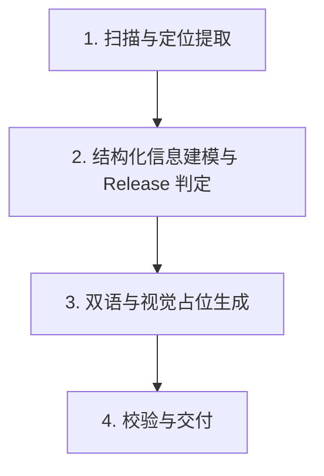

# readme-craft · 独立开源落地页 README 生成技能

本技能专门解决个人/独立开发者开源项目“代码很强但 README 缺少视觉焦点、像记事本、读者容易直接关掉”的问题。
拒绝浮夸用词与中二表达，保持专业沉稳；拒绝过度设计的大厂沉重包袱（不搞双主题切图、不搞繁琐文档站），交付高转化率、高审美、低维护成本的 5 级漏斗结构。

---

## 🎯 核心工作流 (Execution Pipeline)

当用户要求为一个项目编写或重构 README 时，严格执行以下 4 步：

### 步骤 1：扫描与定位提取 (Inspect & Position)
1. 快速检查工作区核心文件（`package.json`、`pyproject.toml`、`Cargo.toml`、入口源码、既有文档或测试用例）。
2. 提炼三大元数据：
   - **一句话穿透力 Slogan**：`[动词] + [解决什么核心痛点/提供什么独特机制]`（陈述事实，杜绝空洞套话）。
   - **技术栈与交付形态**：CLI 工具、前端 Web、Agent Skill、API 库或独立游戏。
   - **核心优势对比**：提取 2~3 个维度的对比项，使用 `✅`（本项目）与 `❌`（传统做法）直观区分。

### 步骤 2：结构化内容组装与 Release 判定
读取 `references/templates.md`，按标准化 5 级漏斗组装内容：

1. **Header (Hero 剧场)**：
   - 右上角单行中英文切换链接。
   - 居中标题与精准 Slogan。
38	   - 3~5 枚 Shields.io 扁平纯色 Badges（版本、通用 Agent 生态兼容、协议，统一 `style=flat-square`）。
39	   - 单行锚点快速导航栏。
40	2. **Primary Proof (核心优势对比表)**：
41	   - 标题固定为 **「💡 核心优势 (Key Strengths)」**。
42	   - 必须使用 Markdown 表格，内容行内统一带 `✅` 与 `❌` 标识，形成强烈视觉反差。
43	3. **Workflow (防御性 Mermaid 流程图)**：
44	   - 严格遵循 `references/mermaid-guide.md` 防御规则：**所有节点文本必须用双引号包裹 `[“...”]`**，只用标准 `flowchart LR` 或 `flowchart TD`，禁止嵌套中英文方括号与 mindmap，确保 GitHub 100% 渲染成功。
45	4. **Onboarding (安装指南 / Quickstart)**：
46	   - **摒弃特定窄众命名，面向全生态 Agent 用户与通用开发者**：
47	     - **方式一：AI 助手一键配置（推荐）**：提供一段全生态通用的提示词（明确支持 Workbuddy、DeepseekHarness、Cursor、GitHub Copilot、Claude Code 等任意主流 Agent）。
     - **方式二：命令行源码运行**：不超过 3 行的克隆、安装与运行指令。
     - **方式三：预构建版本下载 (Releases) —— 必须进行条件判断**：
       - **判定规则**：如果项目是纯文档、提示词包或纯源码仓库，**默认不添加 Release 板块**。
       - **询问与主动提议**：当项目产出可执行二进制（如 Go/Rust/C++）、桌面安装包（Electron/Tauri）、打包 ZIP（如 Agent Skill 归档）或 Docker 镜像时，主动提示用户：
         > *“检测到该项目包含适合分发的独立构件，是否在 README 中添加 Releases 下载板块？如果需要，我可以协助你通过 `gh release create` 打包上传，或者留给你后续自行发布。”*
5. **Footer (工程规范与协议)**：
   - 架构说明或核心特性速查表（长列表使用 `
` 折叠）。
   - 许可证（MIT/Apache-2.0）徽章与链接。

### 步骤 3：视觉占位与提示词补充 (Assets Fallback)
1. 在项目根目录下创建 `assets/README.md`。
2. 为尚未制作图片的开发者生成标准占位规范与 AI 生图提示词（Midjourney/DALL-E 建议词），包含：
   - `assets/hero-banner.png` (推荐 1200x420 宽屏比例)。
   - `assets/demo.gif` (推荐 1280x720 录屏动图)。
3. 在 README 中将图片标签以 HTML 注释形式占位，确保即使没有图片，排版也严丝合缝。

### 步骤 4：双语镜像（可选/按需）
- 默认主文件 `README.md`。
- 若用户需要海外/国际化传播，同步生成对齐版的 `README.en.md`。

---

## 🛡️ 硬性排版守则 (Strict Style Rules)

1. **用词克制专业**：严禁出现“姿势一”、“姿势二”、“中二吹嘘”或“极客专属”等非正式措辞。统一使用“方式一：XXX”、“方式二：XXX”。
2. **表格符号强化**：核心优势对比表中，传统痛点/现有做法必须用 `❌` 标识，本项目解决方案必须用 `✅` 标识。
3. **GitHub Mermaid 绝对兼容**：所有节点文本强制双引号包覆 `["..."]`，子图纯英文 ID。

