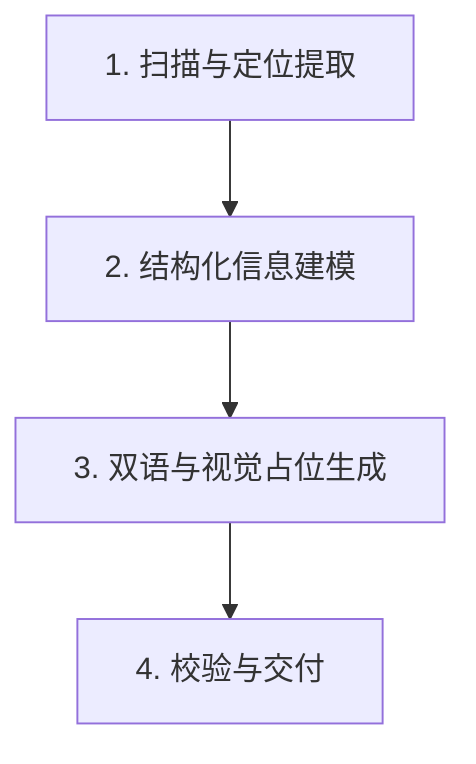

# readme-craft · 独立开源落地页 README 生成技能

本技能专门解决个人/独立开发者开源项目“代码很强但 README 像记事本一样丑、缺少视觉焦点、读者扫一眼就关掉”的痛点。
拒绝大厂过度设计的沉重包袱（不搞复杂的双主题切图、不搞繁琐文档站配置），只交付高转化率、高审美、低维护成本的经典 5 级漏斗结构。

---

## 🎯 核心工作流 (Execution Pipeline)

当用户要求为一个项目编写或重构 README 时，严格执行以下 4 步：

### 步骤 1：扫描与定位提取 (Inspect & Position)
1. 快速检查工作区核心文件（`package.json`、`pyproject.toml`、`Cargo.toml`、入口源码、既有文档或测试用例）。
2. 提炼三大元数据：
   - **一句话穿透力 Slogan**：`[动词] + [解决什么核心痛点/提供什么独特机制]`（拒绝空洞套话）。
   - **技术栈与交付形态**：CLI 工具、前端 Web、Agent Skill、API 库或独立游戏。
   - **核心痛点代差**：列举 2~3 个“传统痛点 vs 本项目解法”。

### 步骤 2：结构化内容组装 (Assemble Modular Blocks)
读取 `references/templates.md`，按标准化 5 级漏斗填充内容：
1. **Header (Hero 剧场)**：
   - 右上角单行中英文切换链接。
   - 居中标题与 Slogan。
   - 3~5 枚 Shields.io 扁平纯色 Badges（版本、平台/语言、协议）。
   - 单行锚点快速导航栏。
2. **Primary Proof (痛点代差矩阵表)**：
   - 用 Markdown 表格对比：`传统痛点 / 现有做法` vs `本项目革新解法` vs `核心增益（Emoji + 数字化）`。
3. **Workflow (防御性 Mermaid 流程图)**：
   - 严格遵循 `references/mermaid-guide.md` 防御规则：**所有节点文本必须用双引号包裹 `["..."]`**，只用标准 `flowchart LR` 或 `flowchart TD`，禁止嵌套括号与 mindmap，确保 GitHub 100% 正常渲染。
4. **Onboarding (三合一极速安装矩阵)**：
   - **通道 A (AI 助手)**：提供一段直接发给 Claude Code / Cursor / Codex 的一键安装提示词。
   - **通道 B (极客 CLI)**：不超过 3 行的克隆、安装与运行指令。
   - **通道 C (Release/开箱即用)**：提供 Releases 直达链接或预编译产物说明。
5. **Footer (工程规范与协议)**：
   - 架构说明或核心特性速查表（长列表使用 `
` 折叠）。
   - 许可证（MIT/Apache-2.0）徽章与链接。

### 步骤 3：视觉占位与提示词补充 (Assets Fallback)
1. 在项目根目录下创建 `assets/README.md`。
2. 为尚未制作图片的开发者生成标准占位规范与 AI 生图提示词（Midjourney/DALL-E 建议词），包含：
   - `assets/hero-banner.png` (推荐 1200x420 宽屏比例)。
   - `assets/demo.gif` (推荐 1280x720 录屏动图)。
3. 在 README 中将图片标签以 HTML 注释形式占位，确保即使没有图片，排版也严丝合缝。

### 步骤 4：双语镜像（可选/按需）
- 默认主文件 `README.md`（可按用户偏好设为中文或英文）。
- 若用户需要海外/国际化传播，同步生成对齐版的 `README.en.md` 或 `README.zh-CN.md`。

---

## 🛡️ 硬性排版与技术守则 (Rules)

1. **GitHub Mermaid 绝对兼容**：
   - 严禁在节点文本内裸写中英括号、冒号、方括号或连字符。
   - 必须写成：`A["输入文字 (带括号说明)"] --> B{"分支判断"}`。
2. **视觉降噪**：
   - 严禁使用花里胡哨不同风格混搭的 Badges。全部统一使用 `style=flat-square`。
   - 严禁一上来就放密密麻麻的配置代码块，长参数一律放入 `

<b>展开查看...</b>

`。
3. **真实性第一**：
   - 拒绝大话空话。命令必须是项目真实可执行的（如 npm、uv、cargo、python），不得虚构依赖。
