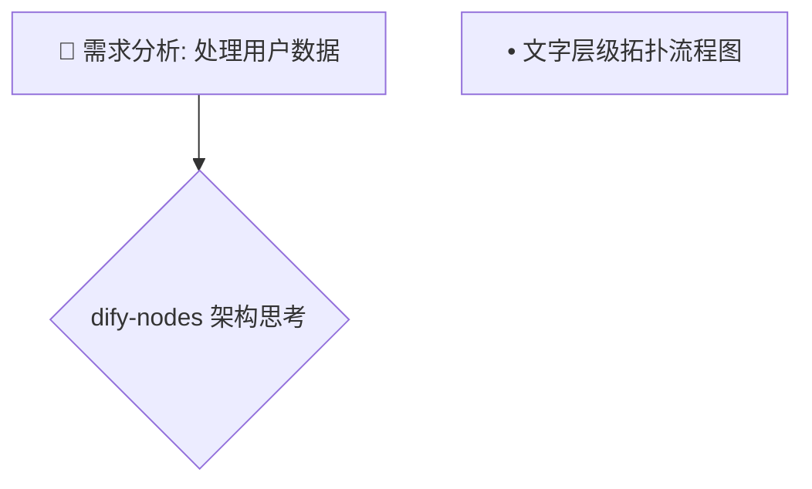
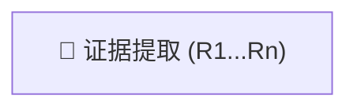
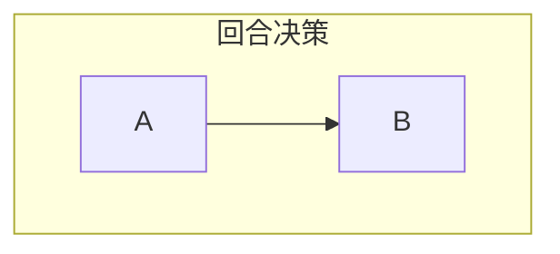
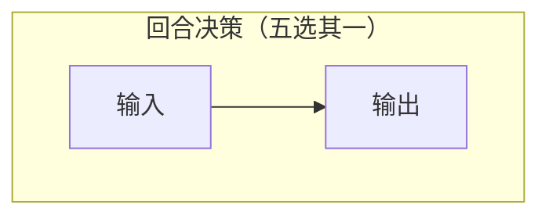
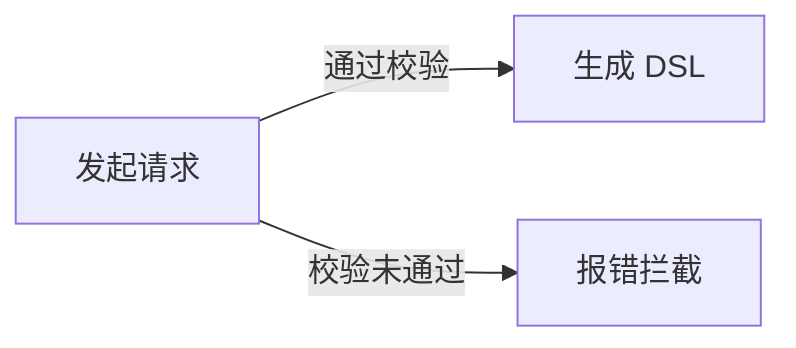

# GitHub Mermaid 防御性编写守则 (GitHub-Safe Mermaid Rules)

GitHub 网页端的 Mermaid 解析器版本演进较慢，且对中文标点、空格与特殊字符极其敏感。任何语法瑕疵都会导致整个图表退化为红色的 `Syntax error in graph`。

为确保 100% 渲染成功，编写时必须严格执行以下防御准则：

---

## 1. 黄金准则：所有节点文本强制双引号包裹

❌ **错误写法（容易因中文符号、冒号或连字符报错）**：


✅ **正确写法（强制双引号包覆文本）**：


---

## 2. 严禁嵌套任何中英文方括号 `[` / `]`

Mermaid 通过方括号 `[...]` 判定矩形节点范围，一旦文本内部出现中英文方括号，解析器会立即在内部方括号处截断导致语法崩溃。

❌ **致命错误**：
```mermaid
graph TD
    A[📌 证据提取 [R1...Rn]]
```

✅ **修复方案（转义为圆括号）**：


---

## 3. 子图 (subgraph) 必须采用「英文ID + 双引号标题」

子图 ID 必须为纯英文或数字，标题放入随后的双引号中。

❌ **脆弱写法**：


✅ **坚固写法**：


---

## 4. 图表类型保守策略：优先使用 flowchart，禁用 mindmap

- **推荐类型**：
  - `flowchart TD` (自顶向下流程)
  - `flowchart LR` (横向步骤流)
  - `sequenceDiagram` (时序交互)
- **避免使用**：
  - `mindmap`（GitHub 移动端与某些渲染管道极不稳定，易白屏）
  - `quadrantChart` / `xychart`（较新特性，低版本解析器直接报错）

---

## 5. 边线文字标注（Edge Labels）

当连线上有说明文字时，文字不得包含管道符 `|`，建议保持简短：

