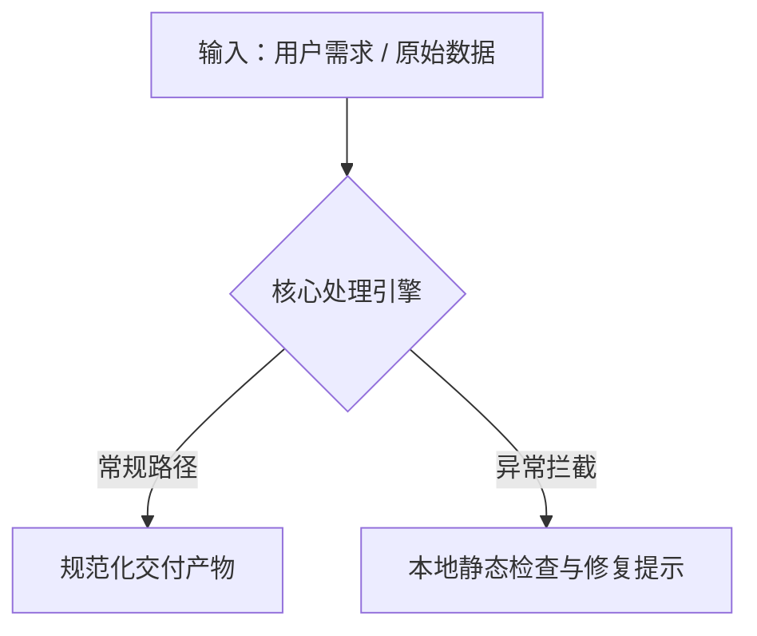

# README 工业级排版模板库 (Template Reference)

本文档提供可直接复用的 Markdown 片段与标准骨架。

---

## 1. 标准落地页骨架 (Standard Skeleton)

```markdown
<p align="right">
  <strong>简体中文</strong> | <a href="./README.en.md">English</a>
</p>

<div align="center">

<!-- [占位] 顶部主视觉横幅：宽屏 1200x420，详见 assets/README.md -->
<!--  -->

# 项目名称 (Project Name)

<p align="center">
  <b>一句话主标题：用最简短有力的话讲透核心定位</b><br>
  副标题：技术架构、独特价值与核心指标
</p>

<p align="center">
  
  
  
</p>

<p align="center">
  <a href="#-痛点与核心代差"><b>💡 核心代差</b></a> •
  <a href="#-业务与架构流程"><b>🔄 架构流程</b></a> •
  <a href="#-极速安装"><b>🚀 极速安装</b></a> •
  <a href="#-功能特性矩阵"><b>✨ 特性矩阵</b></a> •
  <a href="#-开源协议"><b>📄 开源协议</b></a>
</p>

</div>

---

## 💡 痛点与核心代差 (Why This Project)

<!-- [占位] 动图演示：详见 assets/README.md -->
<!-- <div align="center"></div> -->

| 核心维度 | 传统方式 / 现状 | 本项目解决方案 | 核心收益 |
| :--- | :--- | :--- | :--- |
| **效率 / 门槛** | 传统方案步骤冗长、容易出错 | 自动化流水线驱动 | 🚀 节省 90% 时间 |
| **可靠性 / 体验** | 缺乏校验，线上频频崩溃 | 本地静态测试与状态守恒守护 | 🛡️ 零运行时故障 |

---

## 🔄 业务与架构流程 (Workflow)



---

## 🚀 极速安装 (Quickstart)

### 姿势一：AI 助手一键安装 (推荐)
复制以下指令发给你的 AI 编程助手（Claude Code / Cursor / Codex / ZCode）：
```text
请帮我安装此项目：https://github.com/<owner>/<repo>
读取其中的说明并协助我开始使用。
```

### 姿势二：极客 CLI 手动运行
```bash
# 克隆仓库
git clone https://github.com/<owner>/<repo>.git
cd <repo>

# 安装依赖并运行
npm install && npm run dev
# 或 Python uv:
# uv run main.py
```

### 姿势三：Releases 开箱即用
👉 前往 [GitHub Releases](../../releases) 直接下载打包好的可执行文件或扩展包。

---

## ✨ 功能特性矩阵 (Features)

<details open>
<summary><b>展开查看核心特性列表</b></summary>

- [x] **极简上手**：零冗余配置，单行指令即可启动。
- [x] **安全可靠**：数据纯本地处理，零网络外泄隐患。
- [x] **生态友好**：完美契合主流 Agent 与开发者工具链。

</details>

---

## 📄 开源协议

本项目基于 [MIT](LICENSE) 许可证开源。
```

---

## 2. 常用 Shields.io 扁平徽章配置速查

统一建议使用 `style=flat-square`：

| 类别 | 徽章代码 |
| :--- | :--- |
| **版本** | `https://img.shields.io/badge/Version-v0.1.0-blue?style=flat-square` |
| **开源协议** | `https://img.shields.io/badge/License-MIT-green?style=flat-square` |
| **AI Agent 支持** | `https://img.shields.io/badge/Agent-Claude_%7C_Cursor-8a2be2?style=flat-square` |
| **纯前端 / 零依赖** | `https://img.shields.io/badge/Zero-Dependencies-10B981?style=flat-square` |
| **单测通过** | `https://img.shields.io/badge/Tests-Passing-brightgreen?style=flat-square` |
